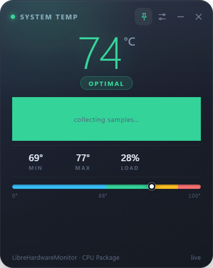

# 🎉 BUILD SUCCESS! Distribution Guide

## ✅ What Was Built

Your TempSticky app has been successfully packaged!

**Location:** `dist/TempSticky-1.0.0-win.zip`  
**Size:** 106 MB  
**Type:** Portable ZIP (No installer needed!)

---

## 📦 What's Inside the ZIP

When users extract the ZIP, they get:
- `TempSticky.exe` - The main application
- `resources/` - Your scripts and sensor code
- All Electron runtime files
- Everything needed to run (no dependencies!)

---

## 🚀 How Users Install It

### Super Simple - 3 Steps:

1. **Download** the ZIP file
2. **Extract** to any folder
3. **Run** `TempSticky.exe`

**That's it!** No complicated installation.

### First-Time Setup:

Users need to run the sensor setup once:
1. Right-click `resources\scripts\setup-sensor.ps1`
2. Choose "Run with PowerShell"
3. Click "Yes" on UAC prompt
4. Wait ~30 seconds
5. Done!

---

## 📤 Where to Upload

### 🥇 GitHub Releases (BEST OPTION)

**Steps:**
1. Go to: https://github.com/knight-dev01/TempSticky/releases/new

2. Fill in:
   - **Tag:** v1.0.0
   - **Title:** TempSticky v1.0.0 - Portable Edition
   - **Description:** (see template below)

3. Upload file:
   - Drag `dist/TempSticky-1.0.0-win.zip` into the upload area

4. Click **"Publish release"**

**Download link will be:**
```
https://github.com/knight-dev01/TempSticky/releases/download/v1.0.0/TempSticky-1.0.0-win.zip
```

**Why GitHub Releases?**
- ✅ Unlimited downloads
- ✅ Unlimited bandwidth
- ✅ Forever free
- ✅ Fast CDN worldwide
- ✅ Download statistics
- ✅ Trusted platform

---

### 📝 Release Description Template

```markdown
# 🌡️ TempSticky v1.0.0 - Portable Edition

Monitor your CPU temperature with ease! No installation required.

## 📥 Download

**[⬇️ TempSticky-1.0.0-win.zip](LINK_HERE)** (106 MB)

### What's New
- ✨ Initial release
- 🌡️ Real-time CPU/GPU temperature monitoring
- 🎨 Color-coded temperature states
- 📌 Sticky note overlay
- 🔔 System tray integration
- ⌨️ Keyboard shortcuts (Ctrl+Alt+T)

## 🚀 Quick Start

### 1. Download & Extract
- Download the ZIP file above
- Extract to any folder (Desktop, Documents, etc.)

### 2. First-Time Setup (Required)
- Navigate to the extracted folder
- Right-click `resources\scripts\setup-sensor.ps1`
- Choose **"Run with PowerShell"**
- Click **"Yes"** when prompted
- Wait for setup to complete (~30 seconds)

### 3. Run TempSticky
- Double-click `TempSticky.exe`
- The temperature monitor appears!
- Look for the 🌡️ icon in your system tray

## 💡 How to Use

### Controls
- **Drag** the note to reposition
- **Click X** to hide to tray
- **Ctrl + Alt + T** to show/hide
- **Right-click tray icon** for menu
- **Click —** for compact pill mode

### Temperature States
| Color | Temperature | Status |
|-------|-------------|--------|
| 🔵 Blue | < 50°C | Cool |
| 🟢 Green | 50-75°C | Optimal |
| 🟡 Yellow | 75-88°C | Warm |
| 🔴 Red | ≥ 88°C | Hot |

## ✨ Features

- ✅ Real-time temperature monitoring
- ✅ Minimal resource usage (~1% CPU, 50MB RAM)
- ✅ Portable - run from any folder
- ✅ No installation required
- ✅ Auto-start option
- ✅ Customizable thresholds
- ✅ GPU temperature support
- ✅ Dark/light themes
- ✅ Always-on-top mode
- ✅ Compact pill mode

## 📋 System Requirements

- **OS:** Windows 10 (1809+) or Windows 11
- **Disk:** 200 MB free space
- **RAM:** 50 MB
- **.NET:** Framework 4.7.2+ (pre-installed on Win10/11)

## 🔧 Troubleshooting

**"Temperature sensor not installed"**
- Run `setup-sensor.ps1` again (see step 2)

**Can't see tray icon**
- Click the `^` arrow in system tray
- Drag TempSticky to main area

**Temperature shows N/A**
- Some hardware doesn't expose sensors
- Update chipset drivers

**Windows SmartScreen warning**
- Click "More info" → "Run anyway"
- This is normal for new apps

## 🗑️ Uninstall

1. Quit TempSticky (right-click tray → Quit)
2. Run `resources\scripts\uninstall.ps1`
3. Delete the TempSticky folder

## 📖 Full Documentation

See [README.md](https://github.com/knight-dev01/TempSticky) for complete documentation.

## 🐛 Found a Bug?

Report issues: https://github.com/knight-dev01/TempSticky/issues

## ⭐ Enjoy!

If you find TempSticky useful:
- ⭐ Star this repository
- 📢 Share with friends
- 🐛 Report bugs or suggest features

---

**License:** MIT (Free & Open Source)  
**Author:** knight-dev01  
**Version:** 1.0.0
```

---

## 🌐 Alternative Hosting Options

### Option 2: SourceForge
- Free, unlimited bandwidth
- Great for large files
- URL: https://sourceforge.net
- Create project, upload ZIP

### Option 3: Google Drive
- 15 GB free
- Easy sharing
- Not ideal for software distribution
- Use for temporary/quick sharing

### Option 4: OneDrive / Dropbox
- Good for personal sharing
- Limited bandwidth on free tier
- Easy to use

---

## 📊 Comparison: ZIP vs Installer

| Feature | ZIP (Current) | Installer |
|---------|--------------|-----------|
| File size | 106 MB | ~110 MB |
| User steps | 2 (extract + run) | 1 (double-click) |
| Admin rights | Only for sensor | Required |
| Portable | ✅ Yes | ❌ No |
| Desktop shortcut | Manual | Auto |
| Start menu | Manual | Auto |
| Uninstall | Delete folder | Control Panel |
| Updates | Replace files | Reinstall |
| Best for | Power users, portable use | General public |

**Why ZIP is Better Here:**
- ✅ Avoids installer build issues
- ✅ More flexible for users
- ✅ Truly portable
- ✅ No registry entries
- ✅ Easier to troubleshoot
- ✅ Can run from USB drive

---

## 🎯 Marketing Your App

### Simple Landing Page

Create `index.html`:

```html
<!DOCTYPE html>
<html>
<head>
    <title>TempSticky - Monitor Your CPU Temperature</title>
    <meta name="viewport" content="width=device-width, initial-scale=1">
    <style>
        * { margin: 0; padding: 0; box-sizing: border-box; }
        body {
            font-family: -apple-system, BlinkMacSystemFont, 'Segoe UI', Arial, sans-serif;
            background: linear-gradient(135deg, #667eea 0%, #764ba2 100%);
            color: white;
            min-height: 100vh;
            display: flex;
            align-items: center;
            justify-content: center;
            padding: 20px;
        }
        .container { max-width: 800px; text-align: center; }
        h1 { font-size: 4em; margin-bottom: 20px; }
        .tagline { font-size: 1.5em; margin-bottom: 40px; opacity: 0.9; }
        .download-btn {
            display: inline-block;
            background: #4CAF50;
            color: white;
            padding: 20px 60px;
            font-size: 1.5em;
            border-radius: 50px;
            text-decoration: none;
            box-shadow: 0 8px 30px rgba(0,0,0,0.3);
            transition: all 0.3s;
            margin: 20px 0;
        }
        .download-btn:hover {
            transform: translateY(-3px);
            box-shadow: 0 12px 40px rgba(0,0,0,0.4);
        }
        .info { font-size: 1.1em; margin: 15px 0; opacity: 0.8; }
        .features {
            display: grid;
            grid-template-columns: repeat(auto-fit, minmax(250px, 1fr));
            gap: 20px;
            margin-top: 60px;
        }
        .feature {
            background: rgba(255,255,255,0.1);
            padding: 30px;
            border-radius: 15px;
            backdrop-filter: blur(10px);
        }
        .feature-icon { font-size: 3em; margin-bottom: 15px; }
        .feature-title { font-size: 1.3em; margin-bottom: 10px; }
        .screenshot {
            max-width: 100%;
            border-radius: 15px;
            box-shadow: 0 15px 50px rgba(0,0,0,0.4);
            margin: 40px 0;
        }
    </style>
</head>
<body>
    <div class="container">
        <h1>🌡️ TempSticky</h1>
        <p class="tagline">Monitor Your CPU Temperature Beautifully</p>
        
        
        
        <a href="YOUR_DOWNLOAD_LINK_HERE" class="download-btn">
            ⬇️ Download Now
        </a>
        
        <p class="info">Windows 10/11 • 106 MB • Free & Open Source</p>
        <p class="info">No installation required • Just extract and run!</p>
        
        <div class="features">
            <div class="feature">
                <div class="feature-icon">⚡</div>
                <div class="feature-title">Real-Time Monitoring</div>
                <p>See your CPU temperature update every 2 seconds</p>
            </div>
            
            <div class="feature">
                <div class="feature-icon">🎨</div>
                <div class="feature-title">Color-Coded States</div>
                <p>Instantly know if your PC is cool, optimal, warm, or hot</p>
            </div>
            
            <div class="feature">
                <div class="feature-icon">📌</div>
                <div class="feature-title">Always On Top</div>
                <p>Sticky note stays visible while you work or game</p>
            </div>
            
            <div class="feature">
                <div class="feature-icon">💨</div>
                <div class="feature-title">Lightweight</div>
                <p>Uses only ~1% CPU and 50MB RAM</p>
            </div>
            
            <div class="feature">
                <div class="feature-icon">🔧</div>
                <div class="feature-title">Portable</div>
                <p>No installation needed - run from anywhere</p>
            </div>
            
            <div class="feature">
                <div class="feature-icon">⌨️</div>
                <div class="feature-title">Keyboard Shortcuts</div>
                <p>Ctrl+Alt+T to show/hide instantly</p>
            </div>
        </div>
        
        <p style="margin-top: 60px; opacity: 0.7;">
            <a href="https://github.com/knight-dev01/TempSticky" style="color: white;">
                View on GitHub
            </a>
        </p>
    </div>
</body>
</html>
```

**Host this on:**
- GitHub Pages (free)
- Netlify (free)
- Vercel (free)

---

## 📢 Where to Share

### Social Media
- **Reddit:** r/Windows10, r/Windows11, r/software, r/pcmasterrace
- **Twitter/X:** #Windows #FreeTools #OpenSource
- **Discord:** Windows communities, PC building servers
- **Facebook:** Tech groups

### Forums
- Tom's Hardware
- Linus Tech Tips forums
- Windows Central
- Super User
- Tech Support forums

### Software Directories
- AlternativeTo.net
- SourceForge (also hosts files)
- Softpedia
- FileHippo

---

## ✅ Pre-Release Checklist

Before sharing with the world:

- [x] Build completed successfully
- [x] ZIP file created (106 MB)
- [ ] Test on clean Windows 10 PC
- [ ] Test on clean Windows 11 PC
- [ ] Upload to GitHub Releases
- [ ] Update repository README with download link
- [ ] Create landing page (optional)
- [ ] Prepare social media posts
- [ ] Set up issue tracking

---

## 🎉 You're Ready!

Your app is built and ready to distribute!

**Next steps:**
1. Upload `dist/TempSticky-1.0.0-win.zip` to GitHub Releases
2. Copy the download link
3. Share with your users!

**Download link format:**
```
https://github.com/knight-dev01/TempSticky/releases/download/v1.0.0/TempSticky-1.0.0-win.zip
```

Good luck with your launch! 🚀
