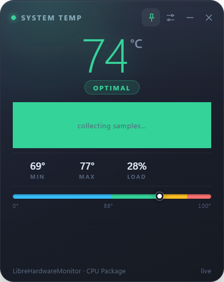

# 🚀 Quick Start Guide - Building & Sharing TempSticky

## For You (The Developer)

### Step 1: Build the Installer (Easy!)

**Option A: Double-click method** (Easiest)
```
1. Double-click: build-installer.bat
2. Wait 2-5 minutes
3. Done! File is in dist/ folder
```

**Option B: Command line**
```bash
npm install
npm run build:win
```

**Output:** `dist/TempSticky Setup 1.0.0.exe` (~100 MB)

### Step 2: Upload to GitHub Releases

1. Go to: https://github.com/knight-dev01/TempSticky/releases/new
2. **Tag:** v1.0.0
3. **Title:** TempSticky v1.0.0 - One-Click Installer
4. **Description:** Copy from INSTALLER_README.md
5. **Upload:** Drag `TempSticky Setup 1.0.0.exe` into "Attach binaries"
6. Click **"Publish release"**

**That's it!** Your download link will be:
```
https://github.com/knight-dev01/TempSticky/releases/download/v1.0.0/TempSticky.Setup.1.0.0.exe
```

### Step 3: Share with Users

Send them this simple message:

```
🌡️ Download TempSticky - Windows Temperature Monitor

One-click installer:
https://github.com/knight-dev01/TempSticky/releases/latest

Just download and double-click! Works on Windows 10/11.
```

---

## For Your Users (Non-Technical)

They just need to:

1. **Download** TempSticky-Setup-1.0.0.exe from GitHub
2. **Double-click** the file
3. **Click "Yes"** on Windows security prompt
4. **Follow the wizard** (3 simple steps)
5. **Done!** App starts automatically

**No coding, no command line, no npm, no git - just click and install!**

---

## 🎯 What the Installer Does Automatically

✅ Installs TempSticky to Program Files  
✅ Sets up temperature sensor (with admin permission)  
✅ Creates desktop shortcut  
✅ Creates Start Menu shortcut  
✅ Offers to auto-start with Windows  
✅ Tests that temperature sensor works  
✅ Launches the app

**Total time:** ~1-2 minutes

---

## 📦 Best Free Hosting Platforms

| Platform | Free Storage | Bandwidth | Best For |
|----------|-------------|-----------|----------|
| **GitHub Releases** | Unlimited* | Unlimited | **Recommended!** |
| SourceForge | 5 GB | Unlimited | Backup option |
| Google Drive | 15 GB | Limited | Quick sharing |
| OneDrive | 5 GB | Good | Microsoft users |
| Dropbox | 2 GB | Limited | Small files |
| MediaFire | 10 GB | Unlimited | Alternative |
| Mega.nz | 20 GB | 5 GB/day | Large files |

*Files up to 2 GB each

**Recommendation:** Use GitHub Releases as primary, SourceForge as backup

---

## 🎨 Marketing Your App

### Simple Landing Page

Create a file `index.html`:

```html
<!DOCTYPE html>
<html>
<head>
    <title>TempSticky - CPU Temperature Monitor</title>
    <style>
        body { 
            font-family: 'Segoe UI', Arial; 
            text-align: center; 
            background: linear-gradient(135deg, #667eea 0%, #764ba2 100%);
            color: white;
            padding: 50px;
            margin: 0;
        }
        .container { max-width: 600px; margin: 0 auto; }
        h1 { font-size: 48px; margin-bottom: 20px; }
        .download-btn { 
            background: #4CAF50; 
            color: white; 
            padding: 20px 50px; 
            font-size: 24px; 
            border-radius: 50px; 
            text-decoration: none; 
            display: inline-block;
            margin: 30px 0;
            box-shadow: 0 4px 15px rgba(0,0,0,0.3);
            transition: transform 0.2s;
        }
        .download-btn:hover { 
            transform: scale(1.05);
            background: #45a049; 
        }
        .features { 
            background: rgba(255,255,255,0.1); 
            padding: 30px; 
            border-radius: 20px; 
            margin: 30px 0;
            text-align: left;
        }
        .feature { margin: 15px 0; font-size: 18px; }
        .screenshot { 
            max-width: 100%; 
            border-radius: 10px; 
            box-shadow: 0 8px 30px rgba(0,0,0,0.3);
            margin: 20px 0;
        }
    </style>
</head>
<body>
    <div class="container">
        <h1>🌡️ TempSticky</h1>
        <p style="font-size: 24px;">Monitor Your CPU Temperature Beautifully</p>
        
        
        
        <a href="https://github.com/knight-dev01/TempSticky/releases/latest" class="download-btn">
            ⬇️ Download for Windows
        </a>
        
        <p>Windows 10/11 • 100 MB • Free & Open Source</p>
        
        <div class="features">
            <div class="feature">✅ Real-time temperature monitoring</div>
            <div class="feature">✅ Color-coded temperature states</div>
            <div class="feature">✅ System tray integration</div>
            <div class="feature">✅ Always-on-top sticky note</div>
            <div class="feature">✅ Compact pill mode</div>
            <div class="feature">✅ Auto-start with Windows</div>
            <div class="feature">✅ Keyboard shortcuts (Ctrl+Alt+T)</div>
            <div class="feature">✅ No ads, no tracking</div>
        </div>
        
        <p>
            <a href="https://github.com/knight-dev01/TempSticky" style="color: white;">
                View on GitHub
            </a>
        </p>
    </div>
</body>
</html>
```

**Host on:**
- GitHub Pages (free): Add to `docs/` folder, enable in repo settings
- Netlify (free): Drag & drop
- Vercel (free): One-click deploy

### Share On

- **Reddit:** r/Windows10, r/Windows11, r/software
- **Discord:** Windows communities
- **Forums:** Tom's Hardware, Linus Tech Tips forums
- **Twitter/X:** Use hashtags #Windows #TechTools
- **YouTube:** Demo video showing installation

---

## 📊 Distribution Checklist

Before releasing:

- [ ] Build installer with `build-installer.bat`
- [ ] Test on clean Windows 10 VM
- [ ] Test on clean Windows 11 VM
- [ ] Upload to GitHub Releases
- [ ] Upload backup to SourceForge
- [ ] Create simple landing page
- [ ] Write release announcement
- [ ] Share on social media
- [ ] Submit to software directories

---

## 🐛 Common Build Issues

**"electron-builder not found"**
```bash
npm install --save-dev electron-builder
```

**"Cannot find icon"**
- Make sure `assets/tempsticky.ico` exists
- Check path in package.json

**Build hangs**
- Check antivirus isn't blocking
- Close any running TempSticky instances
- Restart build

**Installer too large**
- Normal! Includes Electron runtime (~80-100 MB)
- This is expected for Electron apps
- Users only download once

---

## 💡 Pro Tips

### Versioning

Update version in `package.json` before building:
```json
"version": "1.1.0"
```

This updates the installer filename automatically.

### Auto-Updates

For future versions, consider adding:
```bash
npm install electron-updater
```

Then users get automatic updates!

### Code Signing

To remove Windows warnings:
1. Get a code signing certificate ($$$)
2. Sign the installer
3. Windows trusts it immediately

**For now:** Users click "More info" → "Run anyway"

### Analytics (Optional)

Track downloads with:
- GitHub release download stats (free, built-in)
- Google Analytics on landing page
- SourceForge statistics

---

## 🎉 Success!

You now have:
- ✅ A professional Windows installer
- ✅ Free hosting on GitHub
- ✅ Non-technical user setup wizard
- ✅ Desktop shortcuts
- ✅ Auto-start capability
- ✅ Complete documentation

**Users can now:**
1. Download one file
2. Double-click it
3. Start monitoring temperature!

**Next steps:**
1. Build the installer
2. Upload to GitHub Releases
3. Share the link
4. Get feedback
5. Improve and update!

Happy distributing! 🚀
